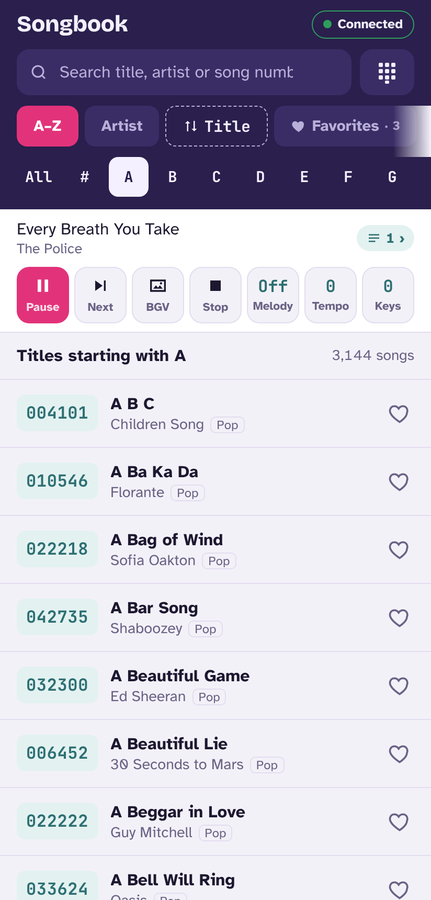
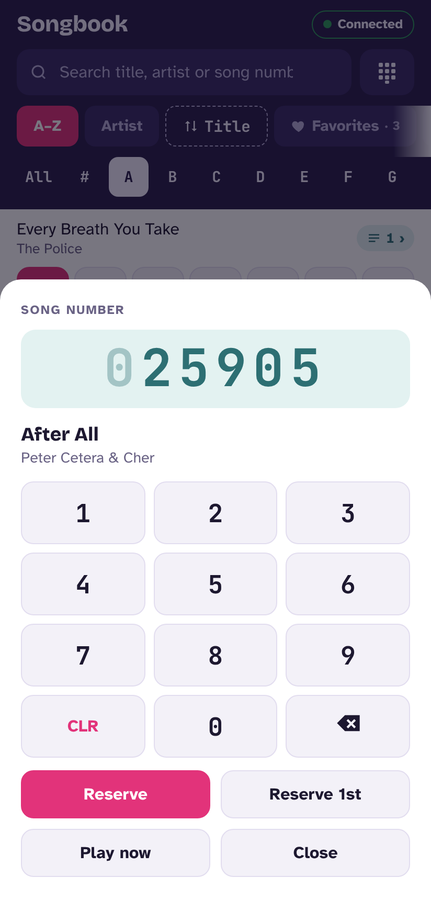
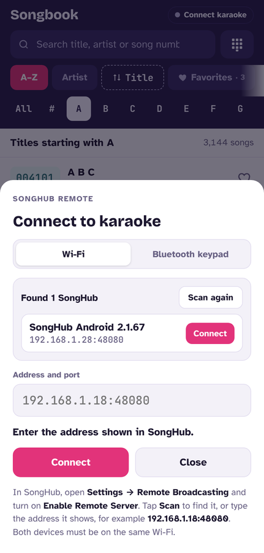
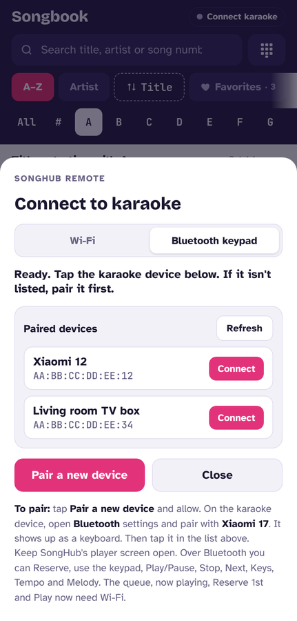
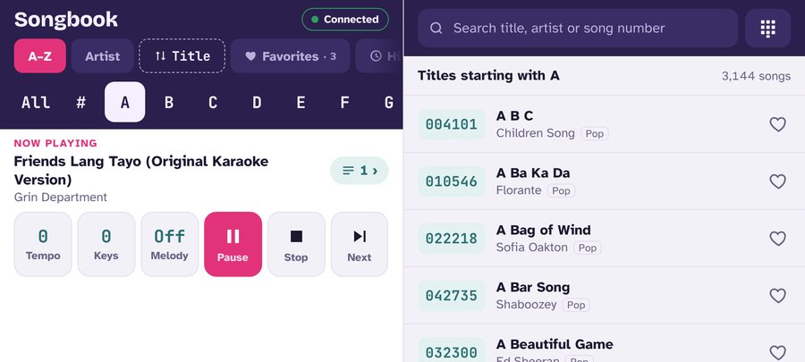

# Songbook for SongHub

A karaoke songbook for Android phones and tablets that works as a remote for the [SongHub](https://github.com/jpdcs/SongHub-Android) karaoke app. Search 47,998 songs by title, artist or number, then reserve and control songs on SongHub over **Wi-Fi**, or by turning the phone into a **Bluetooth keypad**.

<p>




</p>


## Features

- **Song list:** browse A–Z with a letter strip, by artist, Favorites or History. Search by title, artist or song number, and sort by title or by number.
- **Favorites:** tap the heart on any song. **History** lists songs you reserved or played and songs SongHub played, so you can reserve them again.
- **Number keypad:** type a song number and see the matching song before you send it.
- **Remote control:** Reserve, Reserve 1st and Play now, plus a control row of Play/Pause, Next, BGV (change background), Stop, Melody (Off, 20, 40, 60, 80, Max), Tempo and Keys. Also Replay, a live queue and a now-playing display.
- **Layouts:** portrait, landscape split view (controls on the left, songs on the right) and tablet table view. Large text sizes are supported, and it follows dark mode.
- **Offline:** the song list and fonts are inside the app.
- **Updates:** the app checks this page for a newer release (at start, and under **About > Check for updates**) and installs it for you.
- **Backup:** **About > Back up favorites** gives you one line of text with your Favorites and History; **Restore** brings it back on any phone.

## Install

Download the APK from [Releases](../../releases), copy it to your phone and tap it to install. Allow installs from that app if Android asks. It needs Android 5.0 or newer; the Bluetooth keypad needs Android 9 or newer.

**Upgrading from v3.3 or older:** v3.4 is signed with a new key and has a new app ID (`com.daviedz.songbook`), so it installs **next to** the old Songbook instead of replacing it (Android can't update an app signed with a different key). Your old Favorites and History stay in the old app; re-add them in the new one, then uninstall the old app. From v3.4 on, updates install over the top and keep your data.

On Xiaomi phones with a China ROM, the installer may warn "Couldn't find ICP registration info". That's Xiaomi's check for apps registered in China. Tap **Install** to continue.

## Connecting to SongHub

### Wi-Fi (recommended)

1. In SongHub, open **Settings → Remote Broadcasting** and turn on **Enable Remote Server** (port **48080**).
2. In the Songbook, tap **Connect karaoke**. The **Wi-Fi** tab scans your network and lists every SongHub it finds; tap **Connect**. You can also type the address SongHub shows, for example `192.168.1.28:48080`.

Both devices must be on the same Wi-Fi, or one phone's hotspot. Don't set SongHub's Server Port to 48081: SongHub always uses that port for its browser remote page.

### Bluetooth keypad

The phone registers as a Bluetooth keyboard, which SongHub's player responds to.

1. In the Songbook, tap **Connect karaoke → Bluetooth keypad → Pair a new device** and allow it.
2. On the SongHub device, open **Bluetooth settings** and pair with the phone. It shows up as a keyboard.
3. Back in the Songbook, tap the SongHub device in **Paired devices**.
4. Keep SongHub's **player screen** open.

Over Bluetooth you can Reserve, use the live keypad, Play/Pause, Next, BGV, Stop, Melody, Tempo and Keys. Bluetooth only sends keys and nothing comes back, so the queue, now playing, Reserve 1st, Play now and Replay need Wi-Fi. A "Songbook keypad" notification keeps the connection alive in the background.

If pairing fails with "incorrect PIN" after swapping which phone is the keypad, forget the pairing on **both** phones and pair again.

## How it talks to SongHub

**Wi-Fi.** The app uses SongHub's remote WebSocket, `ws://<ip>:48080`, the same protocol as SongHub's official Smart Link remote.

| Action | Message |
|---|---|
| Play now / Reserve | binary `[1]` / `[2]` + song number |
| Play/Pause | binary `[0]` |
| Key ± / Tempo ± | binary `[4, ±1]` / `[5, ±1]` |
| Reserve 1st, Remove | `{"action":"priority"\|"remove","payload":"<number>"}` |
| Next, Stop, Replay, Melody, BGV | `{"action":"next"\|"stop"\|"replay"\|"melody"\|"bgv"}` |

SongHub sends `{"type":"state_update", "queue":[…], "status", "now_playing", "transpose", "tempo", "melody"}`, which drives the queue and the real key, tempo and melody values. **Scan** listens for SongHub's UDP beacon (`SONGHUB_SERVER:<port>` on 48080), checks the local network for port 48080, and confirms each device with SongHub's `welcome` message.

**Bluetooth** (HID keyboard plus consumer keys, as SongHub's player expects):

| Action | Key |
|---|---|
| Song number | 0–9 (SongHub keeps the last 6 digits and clears them after 5 s) |
| Reserve | Enter |
| Delete one digit | retypes the rest padded to 6 digits (e.g. 1234 → `000123`) |
| Clear | Backspace |
| Play/Pause, Stop, Next | Media keys |
| Melody / Key − + / Tempo − + / BGV | F2 / F3 F4 / F5 F6 / F7 |

Back/Esc is never sent, because SongHub uses it to exit the player.

## Building from source

Requirements: bash, Java 17+, Python 3 with `pip install -r requirements.txt`, curl and unzip. The script downloads [Apktool](https://github.com/iBotPeaches/Apktool) 2.10.0, [uber-apk-signer](https://github.com/patrickfav/uber-apk-signer) 1.3.0 and [jadx](https://github.com/skylot/jadx) 1.5.1 (for Google's D8 dex compiler) into `tools/bin/`.

```bash
# sign with your own key, so updates install over an existing install:
export SONGBOOK_KEYSTORE=/path/to/your.jks SONGBOOK_KS_PASS=... SONGBOOK_KEY_ALIAS=...
./build.sh          # -> dist/Songbook-v<version>.apk
```

Without `SONGBOOK_KEYSTORE`, the APK is signed with a debug key. That APK can't update an install signed with a different key.

To change the version, edit `versionCode` and `versionName` in `android/apktool.yml`. The About screen picks it up automatically.

### Project layout

| Path | What it is |
|---|---|
| `web/template.html` | The whole app UI (HTML/CSS/JS). `/*DATA*/` is replaced with the song list at build time. |
| `data/songhub_prebuilt_songlist.xls` | Song list (number, title, artist, category). |
| `scripts/build_data.py` | Converts the song list to compact JSON. |
| `scripts/make_page.py` | Builds `android/assets/index.html` with bundled fonts and the version. |
| `android/` | Apktool project: manifest, resources, fonts, and the small `MainActivity` and `Bridge` in smali. |
| `native/src/` | Java: `NativeWs` (Wi-Fi WebSocket and SongHub scan), `BtKeypad` (Bluetooth HID keyboard), `KeypadService` (keeps the keypad alive in the background). |
| `native/stubs/` | Android API signatures used only to compile the Java. They aren't shipped. |
| `native/fake/`, `native/test/` | Desktop tests of the Java code with simulated Android classes. |
| `tools/mock-songhub/` | Fake SongHub servers (`npm install`, then `node server.js`) for testing on a computer. |

To update the song list, replace the Excel file. It needs the columns `NUMBER`, `TITLE`, `ARTIST` and `CATEGORY`. Then rebuild.

## Credits

Made by **Aldrin** ([Daviedz](https://github.com/Daviedz)).

Credits to the **SongHub developer** for the SongHub karaoke app, its Smart Link remote and the song list this songbook works with. This project is not affiliated with SongHub.

Fonts: Bricolage Grotesque, Atkinson Hyperlegible and JetBrains Mono, via [Fontsource](https://fontsource.org), all under the SIL Open Font License.

See also: [Touch-Keypad-For-Songhub](https://github.com/Daviedz/Touch-Keypad-For-Songhub), an ESP32-S3 touch-screen Bluetooth keypad for SongHub.
